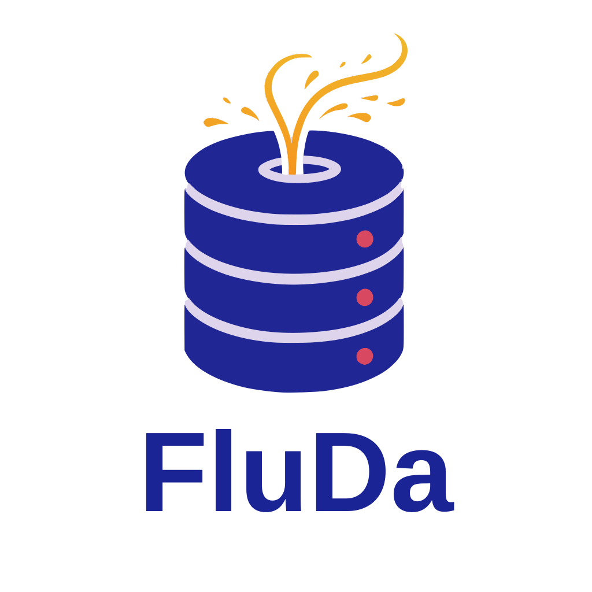

---
hide:
  - navigation
  - toc
  - title
---
<style>
  .md-typeset h1{ 
    display: none; 
  }
</style>
<div class="hero" markdown>

<div markdown style="text-align: center;">

{ width="320" }

</div>

<p class="tagline"><span class="brand">Flu</span>ent <span class="brand">Da</span>ta Toolkit for <strong>Jakarta EE / CDI</strong></p>

A lightweight, modular toolkit for data access, messaging, and application infrastructure — built on standard Jakarta EE and CDI.

[Get Started](documentation/jdbc-client/getting-started.md){ .md-button .md-button--primary }
[GitHub](https://github.com/fludakit){ .md-button }

</div>

## What is FluDa?

FluDa provides a developer-friendly, fluent programming model for data access that mirrors modern APIs like Spring's `JdbcClient` — without the bulk of a full framework. It is organized into six standalone pillars:

<div class="grid cards" markdown>

-   :material-database:{ .lg .middle } **JDBC Client**
    { .card-header }

    A lightweight, type-safe, fluent query engine built directly over JDBC.
    { .card-body }

    → [Getting Started](documentation/jdbc-client/getting-started.md){ .card-link } [:octicons-mark-github-16: jdbc-client](https://github.com/fludakit/jdbc-client){ .card-github }
    { .card-footer }

-   :material-sync:{ .lg .middle } **SQL Initialization**
    { .card-header }

    Automates database schema management and data population on application startup.
    { .card-body }

    → [Getting Started](documentation/sql-init/getting-started.md){ .card-link } [:octicons-mark-github-16: sql-init](https://github.com/fludakit/sql-init){ .card-github }
    { .card-footer }

-   :material-transit-connection-variant:{ .lg .middle } **Transaction Support**
    { .card-header }

    Container-agnostic declarative and programmatic transaction boundaries.
    { .card-body }

    → [Getting Started](documentation/tx/getting-started.md){ .card-link } [:octicons-mark-github-16: tx](https://github.com/fludakit/tx){ .card-github }
    { .card-footer }

-   :material-email-outline:{ .lg .middle } **Mail**
    { .card-header }

    Simple mail abstraction with Jakarta Mail and pluggable providers.
    { .card-body }

    → [Getting Started](documentation/mail/getting-started.md){ .card-link } [:octicons-mark-github-16: mail](https://github.com/fludakit/mail){ .card-github }
    { .card-footer }

-   :material-database-cog:{ .lg .middle } **Data**
    { .card-header }

    A Jakarta Data implementation — `@Repository` interfaces with query-by-method-name, `@Find`, and `@Query`, generated at compile time and executed through `JdbcClient`.
    { .card-body }

    → [Getting Started](documentation/data/getting-started.md){ .card-link } [:octicons-mark-github-16: data](https://github.com/fludakit/data){ .card-github }
    { .card-footer }

-   :material-message-text-outline:{ .lg .middle } **JMS Client**
    { .card-header }

    A fluent Jakarta Messaging client with CDI wiring, payload converters and cached connections.
    { .card-body }

    → [Getting Started](documentation/jms-client/getting-started.md){ .card-link } [:octicons-mark-github-16: jms-client](https://github.com/fludakit/jms-client){ .card-github }
    { .card-footer }

</div>

## Why FluDa?

<div class="grid cards" markdown>

-   :material-feather:{ .lg .middle } **Lightweight**

    Zero framework dependencies — built on standard CDI and Jakarta EE. No Spring, no heavyweight runtime.

-   :material-puzzle:{ .lg .middle } **Modular**

    Use only what you need — core, config, CDI, or any combination — across every pillar.

-   :material-server:{ .lg .middle } **Jakarta EE/CDI Friendly**

    Built on standard Jakarta EE, CDI, Jakarta Data, and MicroProfile Config. Works with GlassFish, WildFly, and any compatible server.

</div>

## Modules

| Pillar | Artifacts | Latest Version | Description |
|--------|-----------|----------------|-------------|
| **JDBC Client** | `core`, `config`, `cdi` | `1.0.0-Beta1` | Fluent query engine over JDBC |
| **SQL Init** | `core`, `config`, `cdi` | `1.0.0-SNAPSHOT` (*In development*) | Automated schema migration on startup |
| **Transaction Support** | `core`, `cdi`, `jdbc`, `jpa` | `1.0.0-SNAPSHOT` (*In development*) | Declarative & programmatic transactions |
| **Mail** | `core`, `config`, `cdi` | `1.0.0-SNAPSHOT` (*In development*) | Mail abstraction with Jakarta Mail and pluggable providers |
| **Data** | `core`, `qbn`, `processor` | `1.0.0-SNAPSHOT` (*In development*) | Jakarta Data repositories generated at compile time |
| **JMS Client** | `core`, `config`, `cdi` | `1.0.0-SNAPSHOT` (*In development*) | Fluent Jakarta Messaging client with CDI wiring |

## Quick example

Add the dependency to your project:

```xml
<dependency>
    <groupId>io.github.fludakit</groupId>
    <artifactId>fluda-jdbc-core</artifactId>
    <version>1.0.0-Beta1</version>
</dependency>
```

Then create a client from any `DataSource` and run fluent queries:

```java
import io.github.fludakit.jdbc.JdbcClient;

// Create a client from any DataSource
JdbcClient client = new JdbcClient(dataSource);

// Fluent queries with named parameters
List<Engineer> engineers = client.sql("SELECT id, name FROM engineers WHERE department = :dept")
        .param("dept", "Engineering")
        .query(Engineer.class)
        .list();

// Updates with generated keys
int rows = client.sql("INSERT INTO engineers (name, department) VALUES (:name, :dept)")
        .param("name", "Ada Lovelace")
        .param("dept", "Engineering")
        .update();
```

See the [getting started guide](documentation/jdbc-client/getting-started.md) for all options.

## Examples

Explore the [example applications](https://github.com/fludakit/examples) for all modules' usages.
